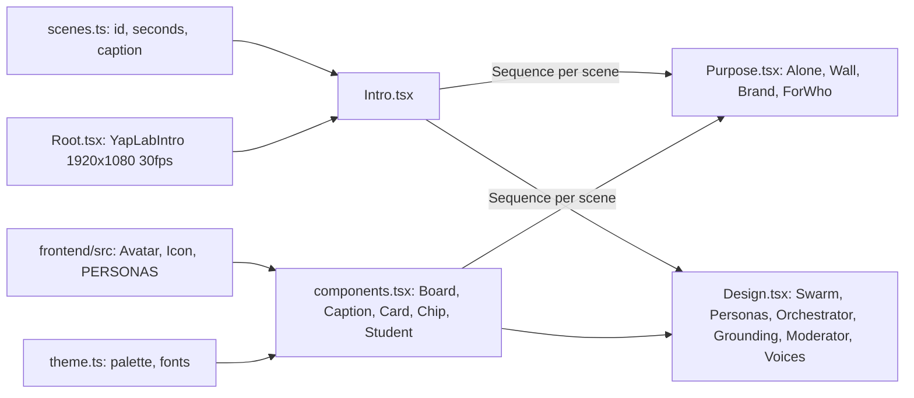

# Design Document

## Overview

The Intro is one Remotion composition made of ten Scenes played back to back. Each Scene is a React component that animates from frame 0 of its own sequence, so Scenes can be reordered or resized without touching each other. Timing and captions live in a single list, and the Intro wraps each Scene with a fade and its Caption.

## Architecture

## Components and Interfaces

| File | Responsibility |
|---|---|
| `src/scenes.ts` | `SCENES` with computed `from` and `frames`; `TOTAL_FRAMES`; `FPS` |
| `src/Root.tsx` | Registers `YapLabIntro` with `{ captions: true }` by default |
| `src/Intro.tsx` | `Sequence` per Scene, `SceneFade` (12-frame edges; 24 on the last), optional `Caption` |
| `src/components.tsx` | `useEnter` (spring), `useProgress` (linear), `rise`; `Board`, `Stage` (keeps clear of the caption band), `Caption`, `Eyebrow`, `Title`, `Accent`, `Card`, `Chip`; `Student` (idle bob, raised-hand badge); `ROOM` (listener → persona label) |
| `src/theme.ts` | Colors from `frontend/src/styles.css`; fonts via `@remotion/google-fonts` |
| `src/scenes/Purpose.tsx`, `src/scenes/Design.tsx` | The ten Scenes |
| `remotion.config.ts` | JPEG frames; webpack alias so `react` and `react-dom` resolve to this package for imports from `../frontend` |

## Data Models

`Scene = { id, part: 'Purpose' | 'Design', seconds, caption, from, frames }`. `IntroProps = { captions: boolean }`.

## Error Handling

Rendering fails fast on type errors (`npm run typecheck`) or missing assets. All assets are code or Google Fonts; there are no media files to go missing.

## Testing Strategy

`tsc --noEmit`, then stills from late in every Scene to check layout, overlap with the caption band, and animation end states, followed by a full render. Stills caught two issues that were fixed: dashed links showing through the orchestrator node, and the progress bar hiding the warm-up segment.
