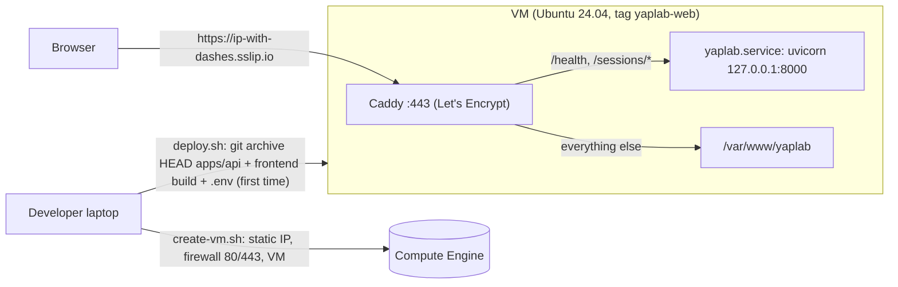

# Design Document

## Overview

A single VM is the simplest host that fits the backend: sessions are held in memory and talk over WebSockets, so the API needs one long-running process rather than serverless functions. Caddy on the same VM terminates HTTPS with an automatic Let's Encrypt certificate, serves the frontend, and proxies the API, so the whole app lives at one origin. A static IP keeps the URL stable, and sslip.io turns that IP into a hostname without buying or configuring a domain. Every action is a short shell script: the laptop side wraps `gcloud`, and the VM side is idempotent so it can run on every deploy.

An earlier iteration published the VM through a Cloudflare Tunnel. Copying the masked tunnel token from the dashboard proved error-prone, and the tunnel added a second system to operate, so it was replaced by direct HTTPS on the VM.

## Architecture



### Deploy flow

```mermaid
sequenceDiagram
    participant L as deploy.sh (laptop)
    participant V as VM
    L->>L: host = PUBLIC_HOST or <static ip>.sslip.io
    L->>L: git archive HEAD apps/api; build frontend from HEAD with VITE_API_URL=https://host
    L->>V: mkdir ~/yaplab-incoming
    L->>V: test -f ~/yaplab/app/.env (push .env if missing or --push-env)
    L->>V: scp release, build, VM scripts, Caddyfile, unit, (.env)
    L->>V: setup.sh (swap, packages, uv)
    L->>V: install.sh (rsync, .env, CORS=https://host, uv sync, unit, restart, health)
    L->>V: install-web.sh (caddy, publish build, Caddyfile for host, restart, wait for HTTPS)
    L->>L: curl https://host/health and https://host/
```

## Components and Interfaces

| File | Responsibility |
|---|---|
| `infra/deploy.env.example` | Documented defaults for Deploy_Config |
| `infra/gcp/_common.sh` | Loads Deploy_Config, derives the region, names the address, tag, and firewall rule; `vm_ssh`, `vm_scp`, `static_ip`, `public_host` |
| `infra/gcp/create-vm.sh` | Static IP (promoting an existing VM's address), firewall rule `yaplab-allow-web`, VM with tag `yaplab-web`; prints the URL |
| `infra/gcp/deploy.sh` | Resolves the host, packages the Release and Web_Build, decides whether to push `.env`, runs the VM scripts, checks the public URL |
| `infra/gcp/logs.sh` | `journalctl -f` for `yaplab` or `caddy` |
| `infra/vm/setup.sh` | Swap under 2 GB of RAM, `curl`/`rsync`/`ca-certificates`, uv |
| `infra/vm/install.sh` | Release install, `.env` handling, CORS, `uv sync --frozen --no-dev`, unit rendering, restart, health wait |
| `infra/vm/install-web.sh` | Caddy install, build publish, Caddyfile rendering for the host, validation, restart, HTTPS wait via `curl --resolve` |
| `infra/vm/Caddyfile` | Site for `__HOST__`: `@api` proxy, SPA fallback, cache headers, compression, admin API off |
| `infra/vm/yaplab.service` | Unit template (`__USER__`, `__APP_DIR__`) running the virtualenv's uvicorn |

## Data Models

GCP resources: address `yaplab-api-ip` (region from the zone), firewall rule `yaplab-allow-web` (tcp:80, tcp:443 to tag `yaplab-web`), VM `yaplab-api`.

VM layout:

```
~/yaplab-incoming/        release tarball, build tarball, VM scripts, Caddyfile, unit, transient .env
~/yaplab/app/             the Release (repo root layout), .env (mode 600), REVISION
~/yaplab/app/apps/api/.venv
/var/www/yaplab/          the Web_Build and its REVISION
/etc/caddy/Caddyfile      rendered for the Public_Host
/var/lib/caddy/           certificates
```

The backend loads `.env` from the repository root relative to its package, so keeping the repository layout under `~/yaplab/app` needs no extra configuration.

## Error Handling

- Missing project, missing static IP, missing local `.env` on first deploy, or missing VM `.env`: the script stops with a message naming the fix.
- Failed health check on the VM: recent `journalctl` output and a non-zero exit, for both the API and Caddy.
- Certificate issuance in progress: `install-web.sh` retries quietly for up to 120 seconds before failing.
- `set -euo pipefail` in every script, so any failing command stops the deploy.

## Testing Strategy

`bash -n` on every script. The Release path was checked locally by extracting `git archive HEAD apps/api`, running `uv sync --frozen --no-dev` with all extras, starting the virtualenv's uvicorn, and requesting `/health`. The live deploy was verified end to end from outside the VM: a Let's Encrypt certificate on the sslip.io host, `/health` and `/` over HTTPS, `POST /sessions` returning 201 through the proxy, and the session WebSocket over `wss://` returning `hello` with the session idle.
