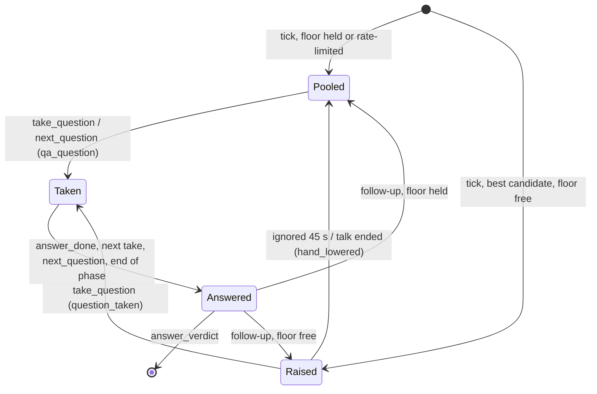
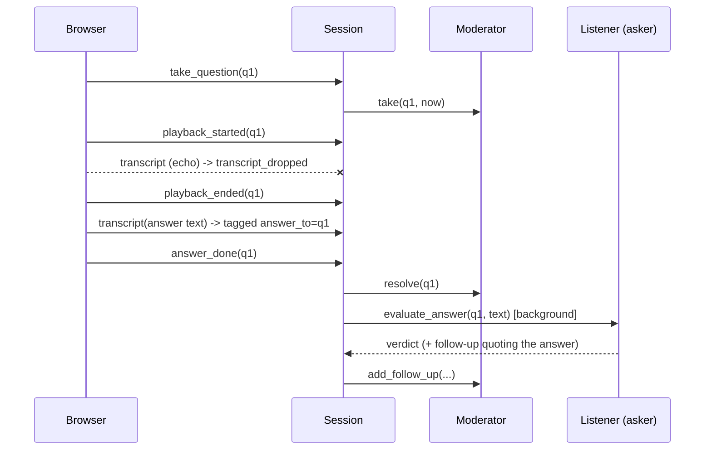

# Design Document

## Overview

The Moderator becomes a small state machine over a single Floor slot plus a ranked pool. The Session turns frontend inputs (final transcript segments, take/playback/answer messages) into Moderator transitions and launches answer judging in the background. All decisions are deterministic code; only judging an answer calls the model.

## Architecture

### Question lifecycle

### Answer flow

## Components and Interfaces

### Moderator (`moderator.py`)

| Method | Behavior |
|---|---|
| `process_tick(hands, now) -> (raised, pooled)` | Drops same-listener same-quote repeats; raises the best candidate if the Floor is free and not rate-limited |
| `expire(now)` / `lower()` | Moves an untaken Raised_Hand to the pool |
| `take(qid, now)` | Raised or pooled → Active; sets the rate-limit time and the listener's call count; `ValueError` if another is active |
| `resolve(qid)` | Frees the Floor |
| `add_follow_up(hand, now) -> bool` | Raise if the Floor is free, else pool |
| `next_qa(now)` | Raised follow-up first, then best pooled until `qa_max_questions` |

Ranking key: `(times_called[listener], -confusion, listener_sort_key(id))`.

### Session (`session.py`)

`ingest_transcript(seq, text, duration)`, `change_slide`, `take_question`, `playback_started/ended`, `answer_done`, `end_presenting`, `next_qa_question` (awaits pending judgements first), `end_qa`, `finish`. Open answers are an `_OpenAnswer(hand, parts)`; closing one schedules `_evaluate` as a tracked task.

### Listener (`agent.py`)

`evaluate_answer(hand, answer_text) -> AnswerVerdict` builds the answer prompt (persona, question, quote, answer), normalizes the verdict, and grounds any follow-up against the answer text only.

### Fake LLM

Deterministic, content-aware verdicts: two or more shared content words between question/quote and answer → `answered`, one → `partial`, none or under five words → `dodged`; follow-ups only for `partial`.

## Data Models

`HandRaise(listener_id, question, question_id, persona, confusion, tick, slide, follow_up_of)`; `AnswerVerdict(question_id, listener_id, verdict, comment, follow_up)`; `TranscriptChunk` extra fields `seq`, `answer_to`.

## Error Handling

- `take_question` with an unknown id or while another answer is open → `SessionError` → WebSocket `error` reply; state unchanged.
- Judging failure → `answer_eval_error`; the session continues.
- Missing `playback_ended` → input resumes after `playback_max_seconds`.

## Testing Strategy

`verify.py` checks: hand lifecycle (raise, block, duplicate drop, expire, take, rate limit from take); Q&A ranking with follow-up first and the limit; session state rules; ingest stamping, seq dedupe, and echo drop with the auto-release; take → answer → verdict → follow-up end to end; follow-up grounding against the answer.
