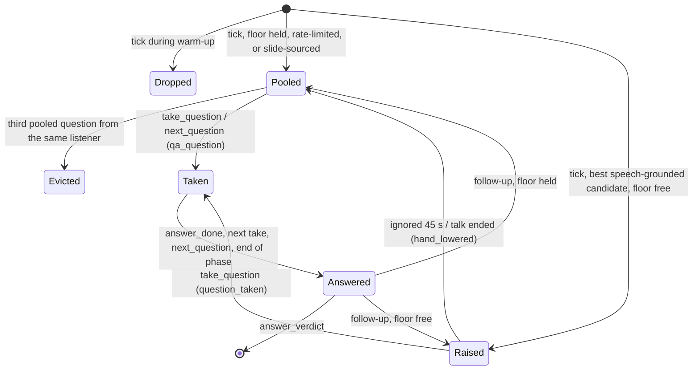
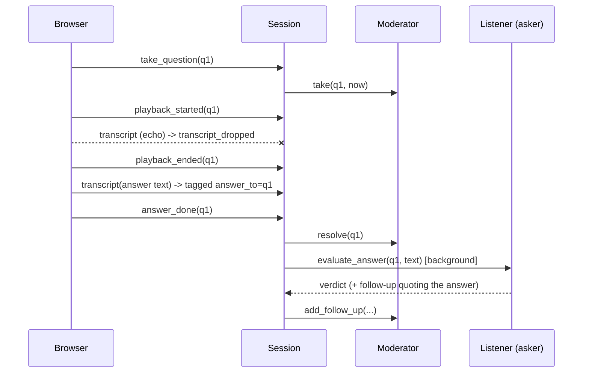

# Design Document

## Overview

The Moderator becomes a small state machine over a single Floor slot plus a ranked pool, gated by a Warm_Up that holds every question until the talk has enough time and spoken words behind it. The Session turns frontend inputs (final transcript segments, take/playback/answer messages) into Moderator transitions and launches answer judging in the background. All decisions are deterministic code; only judging an answer calls the model.

## Architecture

### Question lifecycle

### Answer flow

## Components and Interfaces

### Moderator (`moderator.py`)

| Method | Behavior |
|---|---|
| `start(now)` | Anchors Warm_Up to the talk start |
| `process_tick(hands, now, *, total_word_count) -> (raised, pooled)` | Returns nothing during Warm_Up; drops same-listener same-quote repeats; raises the best Speech_Grounded candidate if the Floor is free and not rate-limited |
| `_pool_tick(candidates)` / `_pool(hand)` | One candidate per listener per tick (highest confusion); at most two held per listener, oldest evicted |
| `expire(now)` / `lower()` | Moves an untaken Raised_Hand to the pool through `_pool` |
| `take(qid, now)` | Raised or pooled → Active; removes a pooled match before lowering the raised hand; sets the rate-limit time and the listener's call count; `ValueError` if another is active |
| `resolve(qid)` | Frees the Floor |
| `add_follow_up(hand, now) -> bool` | Raise if the Floor is free and the follow-up is Speech_Grounded, else pool |
| `next_qa(now)` | Raised follow-up first, then best pooled until `qa_max_questions` |

Ranking key: `(times_called[listener], -confusion, listener_sort_key(id))`.

### Warm-up

`Session.start` records the start time, calls `Moderator.start`, and passes `(started_at, total_word_count)` to `Orchestrator.set_talk_progress`. `ingest_transcript` adds the words of each accepted segment to the running count and refreshes the orchestrator. Each tick passes `total_word_count` to `process_tick` and `talk_elapsed_seconds` to `Listener.react`; the reaction prompt states the elapsed time, and `REACTION_SYSTEM` tells listeners to hold questions about anything not yet explained. Warm_Up ends when both `moderator_warmup_seconds` and `moderator_warmup_min_words` are met; a 0 threshold is skipped. Candidates dropped during Warm_Up never reach `note_question`, so they do not appear in the listener's own-question memory.

### Session (`session.py`)

`ingest_transcript(seq, text, duration)`, `change_slide`, `take_question`, `playback_started/ended`, `answer_done`, `end_presenting`, `next_qa_question` (awaits pending judgements first), `end_qa`, `finish`. Open answers are an `_OpenAnswer(hand, parts)`; closing one schedules `_evaluate` as a tracked task.

### Listener (`agent.py`)

`evaluate_answer(hand, answer_text) -> AnswerVerdict` builds the answer prompt (persona, question, quote, answer), normalizes the verdict, and grounds any follow-up against the answer text only.

### Fake LLM

Deterministic, content-aware verdicts: two or more shared content words between question/quote and answer → `answered`, one → `partial`, none or under five words → `dodged`; follow-ups only for `partial`.

## Data Models

Config: `moderator_warmup_seconds` (45, `FRONTROW_MODERATOR_WARMUP_SECONDS`), `moderator_warmup_min_words` (60, `FRONTROW_MODERATOR_WARMUP_MIN_WORDS`). `HandRaise(listener_id, question, question_id, persona, confusion, tick, slide, follow_up_of)`; `AnswerVerdict(question_id, listener_id, verdict, comment, follow_up)`; `TranscriptChunk` extra fields `seq`, `answer_to`.

## Error Handling

- `take_question` with an unknown id or while another answer is open → `SessionError` → WebSocket `error` reply; state unchanged.
- Judging failure → `answer_eval_error`; the session continues.
- Missing `playback_ended` → input resumes after `playback_max_seconds`.
- A pooled question evicted by the per-listener limit emits no event; earlier `pooled` events stay in the log, and `qa_pool` reports the held set.

## Testing Strategy

`verify.py` checks: hand lifecycle (raise, block, duplicate drop, expire, take, rate limit from take); Q&A ranking with follow-up first and the limit; session state rules; ingest stamping, seq dedupe, and echo drop with the auto-release; take → answer → verdict → follow-up end to end; follow-up grounding against the answer. Fixtures that need immediate hands set both warm-up thresholds to 0.

`verify_natural_hands.py` (joined into `verify.py`, 53 checks in total) covers the warm-up gate by time and by words, the start anchor, which words count, dropped warm-up candidates, slide-only ticks, one candidate per listener per tick, the two-per-listener cap through lower, expire, and follow-up, reserving a taken pooled question before lowering, and unchanged follow-up priority.
