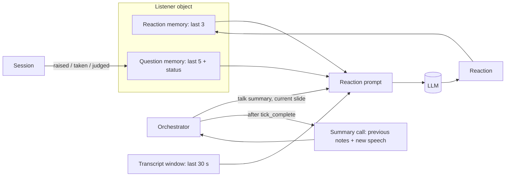

# Design Document

## Overview

Listeners remain stateless model calls. The backend rebuilds each Listener's context every Tick from three sources: its own Reaction_Memory and Question_Memory (kept on the `Listener` object), and the room-wide Talk_Summary (kept on the `Orchestrator`). Slides seen so far come from the Session's Current_Slide.

## Architecture

## Components and Interfaces

### Prompt (`prompts.py`)

`build_reaction_prompt(persona, window_text, slides, *, current_slide, memory, questions, talk_summary)` assembles, in order: persona and question propensity; recent reactions; the Listener's own questions with statuses; "The talk so far, in brief: …"; then the delimited source block (transcript window plus slides up to the Current_Slide). `build_summary_prompt(previous, new_speech)` produces the notes request.

### Listener (`agent.py`)

- `memory: list[(window_text, Reaction)]`; the last `listener_memory_ticks` reactions go into the prompt.
- `questions: list[{id, question, status}]` with `note_question()` and `update_question()`; the last `listener_question_memory` go into the prompt.

Statuses written over a question's life: `hand raised, not asked yet`; `saved for Q&A, not asked yet`; `the presenter called on you; being answered now`; `being asked now in Q&A`; `asked; you judged the answer <verdict>: <comment>`; `follow-up raised, not asked yet` / `follow-up saved for Q&A`.

### Orchestrator (`orchestrator.py`)

- `summarizer: LLMClient | None` (the Session passes its LLM); `None` disables summaries.
- `_update_summary(tick)` runs at the end of `run_tick`: selects chunks with `summarized_until < end <= now`, calls the summarizer, and on success stores the notes (capped) and advances `summarized_until`.
- `set_slide(index)` / `current_slide`; each react call receives `current_slide` and `talk_summary`.

### Fake LLM

Deterministic notes: the previous notes plus the first eight words of each new sentence, keeping the last 800 characters. The `(none yet)` placeholder is ignored.

## Error Handling

A failed summary call keeps the previous notes, records `summary_error`, and leaves `summarized_until` unchanged, so the next attempt retries the same speech. Reactions never wait on the summary.

## Testing Strategy

`verify.py` checks: reaction memory reaches the prompt with persona biases applied; summaries are incremental (each call sees only new speech), shared with other listeners on the next tick, and survive a failed update; a listener's question and its later Verdict appear in its own prompt and not in others'.
