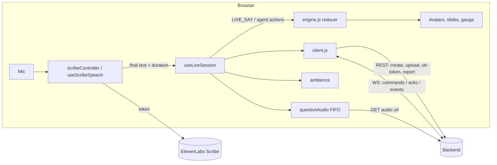

# Design Document

## Overview

The Bridge is mounted beside the demo hooks in `Session.jsx` and enabled only in Live_Mode. It talks to the Backend through a small transport client, owns speech input (Scribe) and question audio, and translates backend events into the same reducer actions the demo engine uses, so the room UI is shared between demo and live sessions. Provider keys never reach the browser; Scribe uses a backend-minted single-use token.

## Architecture

## Components and Interfaces

| Module | Responsibility |
|---|---|
| `client.js` | REST (`createSession`, `uploadDeck`, `getSttToken`, `getReport`) and `connect()` with request/ack correlation, timeouts, reconnect with replay, `4404` handling |
| `protocol.js` | JSDoc types for the backend wire contract |
| `scribeController.js`, `useScribeSpeech.js` | Scribe lifecycle, English-only connect options, seq and duration, mute filtering, ack-gated captions |
| `useLiveSession.js` | Session lifecycle, event handling, hands, meters, room gauge, slide sync, report |
| `hookState.js` | Bounded diagnostics, hand updates that publish only on change, slide-intent sync |
| `mapEvents.js` | Listener_Map, persona mapping, events → avatar actions, meters, gauge |
| `sessionState.js` | Hand reducer, transcript sequence from replay, phase from `hello`, demo deck → slide text |
| `questionAudio.js` | FIFO playback, backend audio cache, playback messages, browser speech fallback, mic muting |
| `ambience.js` | Room tone and throttled effects with `BASE_URL` sound paths |
| `liveConfig.js` | Live config with the fixed five-avatar audience |
| `LiveControls.jsx`, `LiveReport.jsx` | Live controls (call on, done answering, end talk, next question, finish) and the backend report view |
| `dev/LiveHarness.jsx`, `live-test.html` | Test_Bench with opt-in logs and typed transcripts |

### App integration

- `Session.jsx`: `liveMode = Boolean(API_URL) && config.mode === 'teaching'`; transcripts dispatch `LIVE_SAY`; slides update locally, then `live.setSlide()`; when `live.report` arrives, `onEnd({kind: 'live', report, config})`.
- `engine.js`: `LIVE_SAY` appends presenter text and counts words and fillers without touching agent state.
- `App.jsx`: stores the Live_Report_Envelope and renders `LiveReport` for it; the header chip is "Backend live" only for live Teaching.

## Data Models

Hands keyed by question id with status (`raised`, `taken`, `answered`, ...); the active question; listener meters; room gauge; transcript acks; Live_Report_Envelope.

## Error Handling

- Request errors and backend `error` replies surface in the live controls; slide sync failures keep the intended slide for resend.
- Missing or failed question audio falls back to browser speech after 5 seconds.
- Autoplay rejection shows "Enable audio".
- A backend restart loses in-memory sessions; `4404` tells the presenter to start a new session.

## Testing Strategy

`npm run test:live` (Node test runner, 63 tests): transport correlation and replay, persona mapping, live reducer state, Scribe sequence, duration and mute filtering, English connect options, audio FIFO and fallback lifetime, ambience throttles and prefixed URLs, hook state helpers. Manual checks with the Test_Bench and the product UI against a running backend cover microphone capture and audible voice quality.
