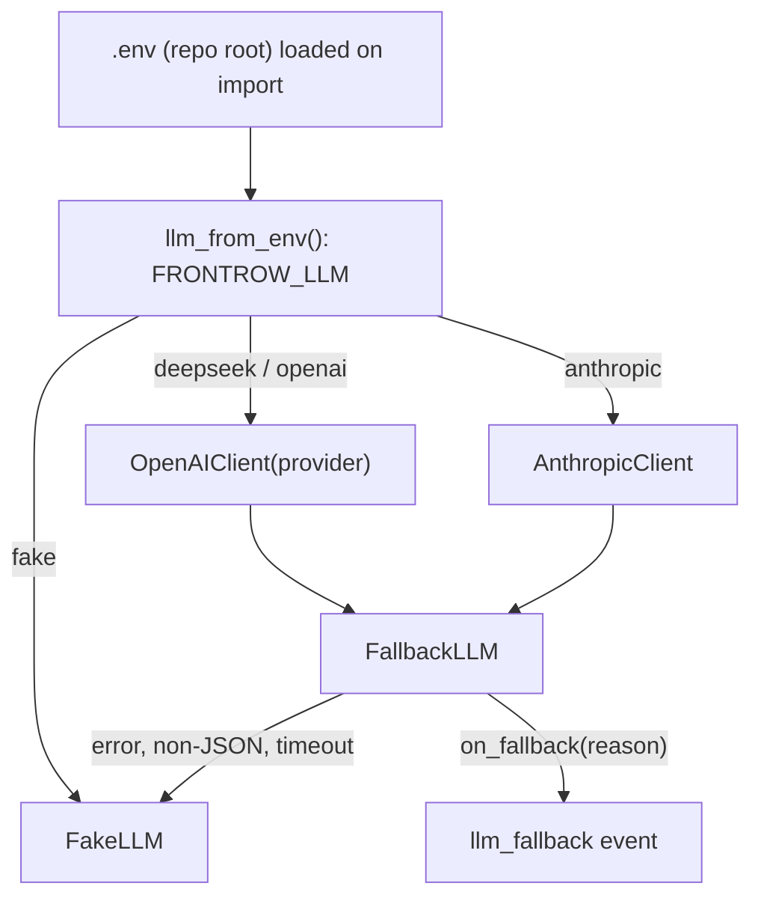

# Design Document

## Overview

Model access stays behind the existing `LLMClient` interface (`complete` / `complete_json`). Provider choice is resolved once at startup from `FRONTROW_LLM` into a factory that builds one client per session. Real clients are always wrapped in `FallbackLLM`, so failures degrade to the deterministic `FakeLLM` instead of stalling a tick.

## Architecture



## Components and Interfaces

### Provider table (`llm/openai_client.py`)

```python
PROVIDERS = {
    "openai":   Provider(base_url=None, api_key_env="OPENAI_API_KEY", default_model="gpt-4o-mini"),
    "deepseek": Provider("https://api.deepseek.com", "DEEPSEEK_API_KEY", "deepseek-flash"),
}
```

`OpenAIClient(api_key=None, provider="openai")` builds `AsyncOpenAI(api_key, base_url)`. Each request sets `response_format={"type": "json_object"}` and `max_tokens=400`; the reaction, answer, and summary prompts all contain the word "JSON", which DeepSeek's JSON mode requires.

### Anthropic client (`llm/anthropic_client.py`)

`AsyncAnthropic(api_key, max_retries=0)`. The system prompt gains a "return exactly one JSON object" suffix; the reply's text blocks are parsed with `parse_json_object` and re-serialized. Thinking is disabled for `claude-haiku-5-5`.

### Selection (`server.llm_from_env`, `replay.make_llm`)

`fake` → `FakeLLM`; a `PROVIDERS` key → `FallbackLLM(OpenAIClient(provider=kind))`; `anthropic` → `FallbackLLM(AnthropicClient())`; anything else raises. `create_app` calls the factory once at startup and keeps that instance for shutdown cleanup.

### Default model (`config._default_model`)

Resolved from `FRONTROW_LLM`: `anthropic` → `claude-haiku-5-5`; a `PROVIDERS` entry → its `default_model`; otherwise `gpt-4o-mini`. `_env_str` treats blank values as unset, so `FRONTROW_LLM_MODEL=` in `.env` means "provider default".

### Fallback (`llm/fallback.py`)

`FallbackLLM(primary, fallback=FakeLLM(), on_fallback=None)` races the primary with `asyncio.wait_for(timeout)`. `TimeoutError` reports `timeout`; any other exception, including JSON parse errors, reports `error: <Type>`. Each `Session` sets `on_fallback` to record `llm_fallback` on its own timeline. `aclose()` closes the primary and a real fallback once each.

### Environment loading (`config.load_env_file`, `frontrow/__init__.py`)

`python-dotenv` loads `<repo>/.env` with `override=False` when the package is imported, before anything reads the environment.

## Error Handling

| Situation | Behavior |
|---|---|
| Unknown `FRONTROW_LLM` | `RuntimeError` at startup listing `fake`, the `PROVIDERS` keys, and `anthropic` |
| Missing key or SDK | `RuntimeError` naming the variable or `uv sync --extra ...` command, raised at startup |
| Provider error, timeout, or non-JSON reply | Fake LLM answers; `llm_fallback` recorded with the reason |
| Empty reply (possible with DeepSeek JSON mode) | Parse error → fallback |

## Testing Strategy

- `verify.py` covers the fallback for error, non-JSON, and timeout, and forces the fake provider.
- `verify_voice_integration.py` covers provider defaults, factory selection, Anthropic JSON handling, and close-once forwarding with in-memory SDK stand-ins.
- Manual check: a request with a dummy key against `api.deepseek.com` returned an authentication error and fell back, confirming the base URL and SDK wiring.
