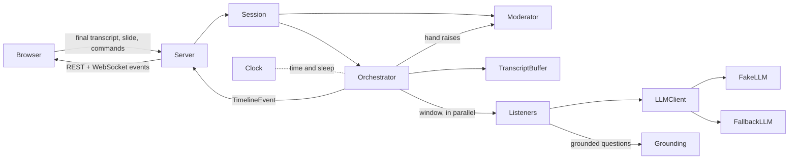
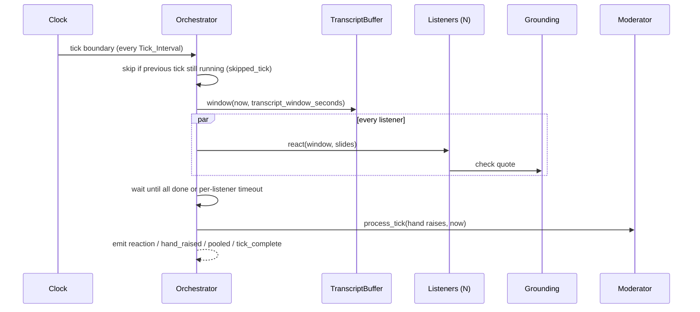

# Design Document

## Overview

The FrontRow backend is an asyncio Python service in `apps/api/frontrow/`. A Session owns a transcript buffer, a room of Listener agents, a Moderator, and an Orchestrator. The Orchestrator wakes every Tick_Interval on an injected Clock, sends the latest transcript window to every Listener in parallel, enforces a per-Listener timeout, grounds any Questions, and lets the Moderator decide who gets the floor. Every step is appended to a timeline of `TimelineEvent`s, which the Server streams to WebSocket clients.

All model access goes through an `LLMClient` interface. A deterministic `FakeLLM` and a `SimulatedClock` make the whole system runnable and testable offline, with byte-identical timelines across runs.

## Architecture

### Tick sequence

## Components and Interfaces

| Component | Module | Responsibility |
|---|---|---|
| Config | `config.py` | Tunables with validation (tick 1-300 s, per-listener timeout below tick); `Config.from_env()` |
| Clock | `clock.py` | `RealClock` (session-relative monotonic time) and `SimulatedClock` (advances only on `advance()`) |
| TranscriptBuffer | `transcript.py` | Stores chunks; `window(now, seconds)` returns chunks whose end is in `[now - seconds, now]` |
| Listener | `agent.py` | One persona; builds the prompt, calls the LLM, applies persona biases, clamps 0-100, grounds the question, keeps memory |
| Grounding | `grounding.py` | Accepts a question only if its quote (>= 10 chars) appears in the transcript window or a slide; stores the exact source span |
| Moderator | `moderator.py` | At most one hand up at a time, rate limit, Q&A pool |
| Orchestrator | `orchestrator.py` | Tick loop, concurrent fan-out, timeouts, failure isolation, backpressure, timeline |
| Session | `session.py` | State machine (idle, presenting, qa, reporting, ended) and inputs from the browser |
| LLM clients | `llm/` | `LLMClient` base, `FakeLLM`, `FallbackLLM`, provider clients |
| Server | `server.py`, `protocol.py` | FastAPI REST + WebSocket, typed wire messages |

## Data Models

Pydantic v2 models in `models.py`: `Slide(index, text)`, `TranscriptChunk(start, end, text)` (rejects `end < start`), `Persona(name, description, attention_bias, confusion_bias, question_propensity)`, `Reaction(listener_id, attention, confusion, understood, question, slide)`, `GroundedQuestion(question, quote, source)`, `HandRaise`, `TimelineEvent(type, t, data)`, and the `SessionState` enum with `PERMITTED_TRANSITIONS`.

## Error Handling

- A Listener that raises is excluded from the tick and recorded as `listener_error`; one that exceeds the timeout is cancelled and recorded as `listener_timeout`. The tick always completes.
- A tick still running at the next boundary causes `skipped_tick`; at most one tick runs per session.
- A question whose quote is not found is dropped and recorded as `grounding_rejected`; the reaction is kept.
- Invalid session transitions raise `SessionError`, surfaced to clients as `error` messages.
- The real LLM path is wrapped in `FallbackLLM`, which answers from `FakeLLM` on error, unparseable JSON, or timeout and records `llm_fallback`.

## Testing Strategy

- `apps/api/verify.py`: a dependency-light runner of plain assertion checks, fully offline with `FakeLLM` and `SimulatedClock` (windowing, clock ordering, grounding, isolation of failing and slow listeners, moderator rules, determinism, session rules, server end to end).
- `python -m frontrow.replay` / `demo.py`: replays `scenarios/sample_talk.json` on a simulated clock and prints the room score per tick.
- `python -m frontrow.fake_client`: a scripted browser against a running server.
