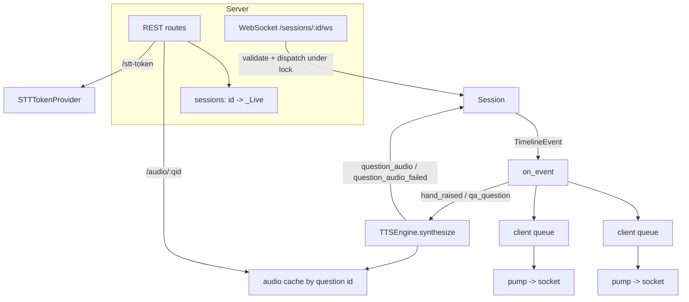

# Design Document

## Overview

`create_app()` builds a FastAPI app around an in-memory registry of live sessions. Each `Session` is created with an event sink that fans its timeline out to per-client queues and, for spoken question events, schedules text-to-speech. All dependencies (config, LLM factory, speech engines, clock) are injectable for tests.

## Architecture

## Components and Interfaces

### REST

| Route | Result |
|---|---|
| `GET /health` | `{ok, sessions}` |
| `POST /sessions` | `201 SessionInfo` |
| `POST /sessions/upload` | `201 SessionInfo` from a PDF |
| `GET /sessions/{id}` | `SessionInfo` |
| `GET /sessions/{id}/events?since=N` | timeline backlog |
| `POST /sessions/{id}/stt-token` | token, `501`/`502`/`409` |
| `GET /sessions/{id}/audio/{qid}` | cached audio or `404` |
| `GET /sessions/{id}/report` | v0 summary or `409` |

### WebSocket

On connect: accept; unknown session → error + close `4404`. Otherwise the `hello` message is queued and the client subscribed with no await in between, so backlog and live stream neither overlap nor gap. A `pump` task is the single writer per socket. Each incoming text frame is validated with a discriminated union (`client_message_adapter`) and dispatched under the session's `asyncio.Lock`; replies go through the same queue.

| Command | Session call | Ack `result` |
|---|---|---|
| `start` | `start()` | `{}` |
| `transcript {seq, text, duration?}` | `ingest_transcript` | `{accepted}` |
| `slide {index}` | `change_slide` | `{}` |
| `take_question {question_id}` | `take_question` | `{question_id}` |
| `playback_started/ended`, `answer_done` | matching method | `{}` |
| `end_presenting` | `end_presenting()` | `{qa_pool}` |
| `next_question` | `next_qa_question()` | `{question_id, done}` |
| `end_qa`, `finish`, `ping` | matching method | `{}` / `{pong: true}` |

### Speech seams (`speech.py`)

`TTSEngine`, `STTTokenProvider` protocols; `SpeechAudio(data, content_type)`; `STTToken(token, provider, expires_in_seconds, extra)`; stand-ins `NoTTS`, `NoSTTTokens`; `SpeechNotConfigured`. Engines are selected by `FRONTROW_TTS` / `FRONTROW_STT` (`none` or `elevenlabs`).

### Protocol (`protocol.py`)

Pydantic models for every Command and for `hello`, `event`, `ack`, `error`, plus `CreateSessionRequest` and `SessionInfo`; `python -m frontrow.protocol` prints the JSON schema.

### Slides (`slides.py`)

`extract_slides(bytes)` validates size, emptiness, and the `%PDF-` header, then extracts per-page text with pypdf.

## Data Models

`_Client(queue, overflowed)`; `_Live(session, clients, audio, tasks, lock)`. Sessions live only in memory.

## Error Handling

- Validation failure → `error` with Pydantic details, socket kept open.
- `SessionError` → `error` with the message.
- A slow client is dropped (`1013`) instead of applying backpressure to the session.
- TTS failures become `question_audio_failed`; provider exception bodies are not exposed.

## Testing Strategy

`verify.py` runs a full session through FastAPI's test client with stub TTS and STT engines: REST validation, PDF upload (generated in memory), token minting, unknown-session rejection, malformed messages, duplicate transcript seq, ticks, Q&A with audio fetched by URL, and the report. `python -m frontrow.fake_client` exercises a real running server.
