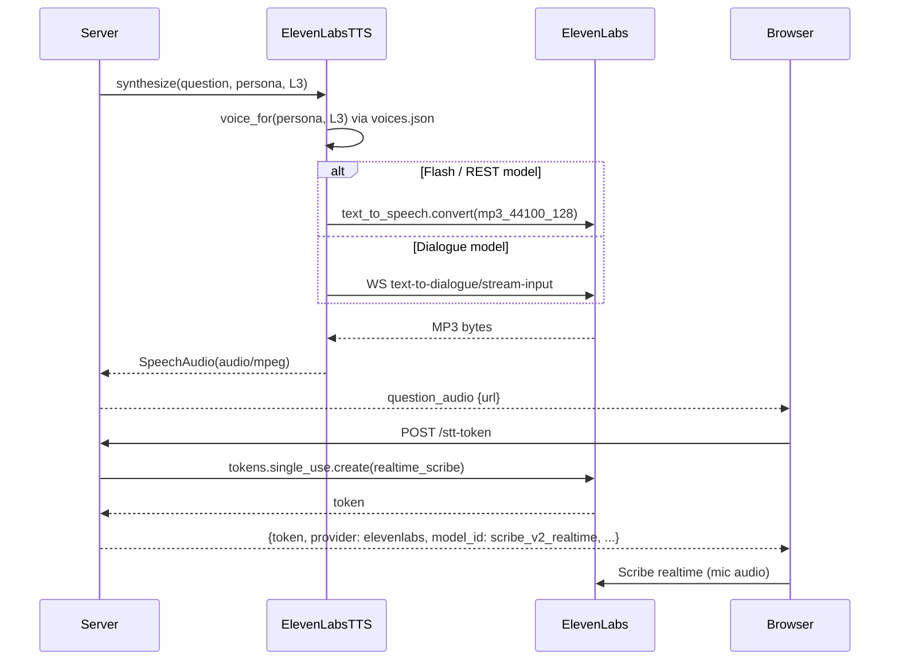

# Design Document

## Overview

`frontrow/speech_elevenlabs.py` implements the existing `TTSEngine` and `STTTokenProvider` protocols, so the server, session, and protocol are unchanged. Both engines share `_ElevenLabsEngine`, which validates the SDK and key, owns one pooled `httpx.AsyncClient`, and supports `aclose()`.

## Architecture

## Components and Interfaces

| Component | Responsibility |
|---|---|
| `server._speech_provider_kind` / `_tts_from_env` / `_stt_from_env` | Validate `FRONTROW_TTS` / `FRONTROW_STT`; lazily import the ElevenLabs module only when selected |
| `_ElevenLabsEngine` | SDK/key validation, pooled HTTP client, `aclose()`, closed-engine guard |
| `ElevenLabsTTS` | Voice_Map validation, `voice_for()`, REST or dialogue synthesis, timing logs |
| `ElevenLabsSTTTokens` | Single-use Scribe token with the browser's connection extras |
| `voices.json` | Persona → voice id list (2-4 voices per persona, disjoint across personas) |
| `scripts/list_voices.py` | Lists account voices with age/gender/accent labels |

## Data Models

`SpeechAudio(data: bytes, content_type="audio/mpeg")`; `STTToken(token, provider="elevenlabs", expires_in_seconds=900, extra={model_id, language_code, vad_silence_threshold_secs, include_timestamps})`.

## Error Handling

`SpeechProviderError` carries only a generic message; any other exception is logged by type and re-raised as `SpeechProviderError`. The server turns TTS failures into `question_audio_failed` events and token failures into HTTP `502`.

## Testing Strategy

`verify_voice_integration.py` (merged into `verify.py`): provider defaults and factories, optional-dependency errors, Voice_Map validation, disjoint voices per room preset, client reuse and token contract, sanitized failures, injected engines ignoring environment settings, shutdown settling late voice tasks before closing clients, close-once forwarding, and the dialogue WebSocket transport, all with in-memory SDK stand-ins. `docs/voice-verification.md` records the real-provider checks and measurements.
