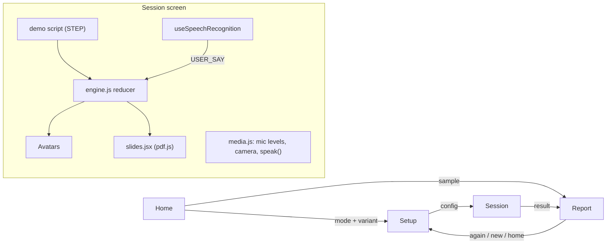

# Design Document

## Overview

A Vite + React 18 single-page app with screen-level state in `App.jsx` (home → setup → session → report). Static content (Personas, Modes, Variants, Decks, checklists, scripted replies) lives in `data.js`. The session screen runs a reducer from `lib/engine.js`; in demo mode a script drives that reducer on a clock, and the same reducer accepts audience events from a backend.

## Architecture

## Components and Interfaces

| Module | Responsibility |
|---|---|
| `App.jsx` | View routing, roster and config state, header mode chip |
| `screens/Home.jsx`, `Setup.jsx`, `Session.jsx`, `Report.jsx`, `InterviewComingSoon.jsx` | The four screens plus the interview placeholder |
| `components/Avatar.jsx`, `Icon.jsx` | Animated persona avatars and icons |
| `data.js` | `PERSONAS`, `MODES` with Variants, `DECKS`, `CHECKLISTS`, `REPLIES`, `FILLER_RE` |
| `lib/config.js` | `defaultConfig`, `sessionTitle`, fields carried across Variants |
| `lib/engine.js` | `buildScript`, `initialState`, `reducer` (CLOCK, STEP, USER_SAY, SET_SLIDE, AGENT_EVENT, ...), `computeResult`, `simulateFull` |
| `lib/agentEvents.js` | Maps audience events to reducer actions |
| `lib/media.js` | Mic level meter, camera stream, Web Speech recognition, `speak()` via speech synthesis or an audio URL |
| `lib/slides.jsx` | Page rendering for uploaded PDF (pdf.js) or image decks |
| `lib/api.js` | Demo-mode flag (`VITE_API_URL` unset) and the original backend sketch |

## Data Models

`config`: mode, variant, deck, checklist, seriousness, agents, noise, camera, voices, roster, slides, and mode-specific fields. Engine state: elapsed time, slide, transcript, per-slide stats, words per minute, fillers, pauses, agent states, hints, questions. `Result`: transcript, per-slide results, pace, fillers, pauses, coverage, category scores, overall score.

## Error Handling

Browser capabilities are optional: missing speech recognition, microphone, camera, or speech synthesis fall back silently (no transcription, no meter, no self-view, text-only replies).

## Testing Strategy

`npm run build` for type and bundling errors; manual walkthrough of each Mode and the sample report. Live-bridge behavior has its own automated tests (see `live-teaching-bridge`).
