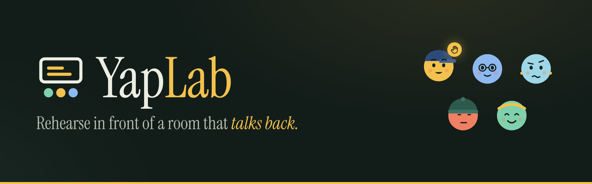
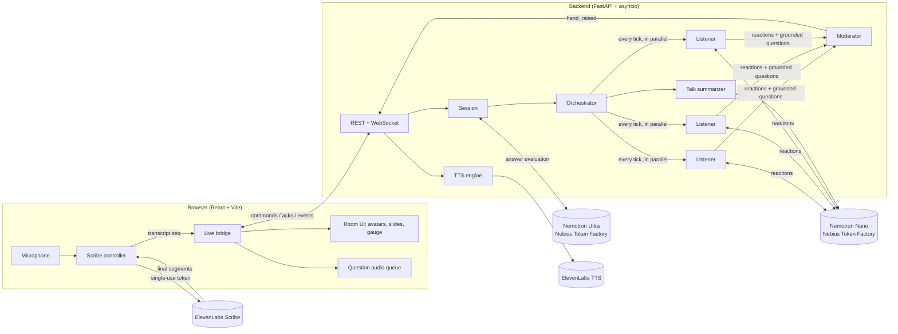
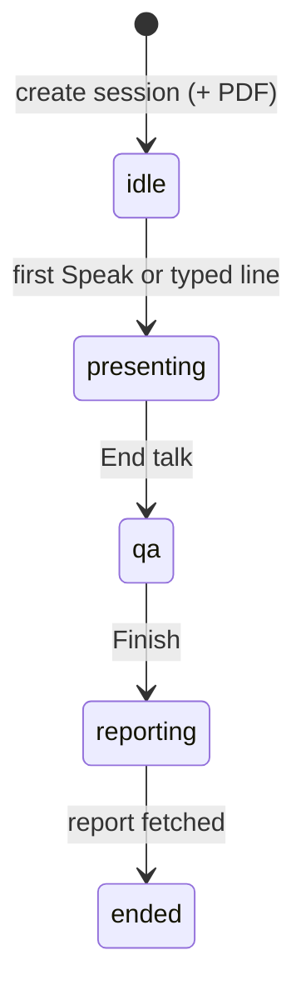
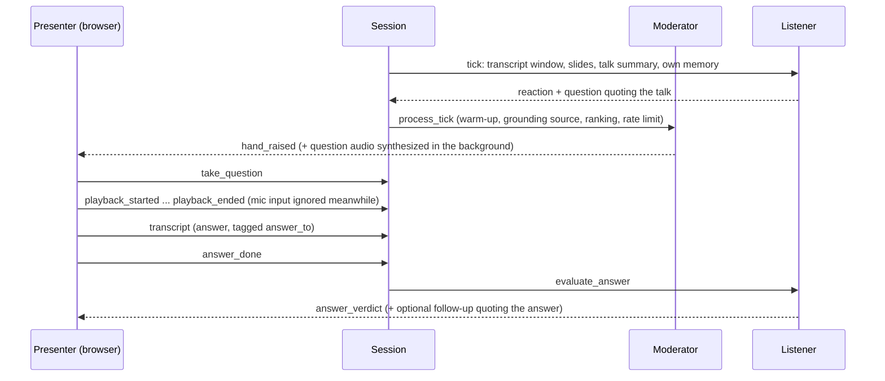

<p align="center">
  
</p>

<p align="center">
  <a href="#quick-start">Quick start</a> ·
  <a href="#architecture">Architecture</a>
</p>

#  YapLab

A practice classroom full of AI students.

Upload your slides, start talking, and a room of AI listeners reacts in real time. A confused first-year, a skeptical professor, an ESL student, a distracted student, and a domain expert each listen differently. They drift off when you ramble, raise their hands when something you explained is unclear, ask their questions out loud, and judge whether you actually answered. When you finish, you get a report on how the room followed you.

First built at BU DS+X 2026. Runs on NVIDIA Nemotron through Nebius Token Factory (Nebius x NVIDIA Global AI Hackathon, Best Apps and Agents track).

> **Naming:** the product is **YapLab**. The original code name, FrontRow, remains in the Python package (`frontrow`), the settings (`FRONTROW_*`), and the internal docs.

## Powered by NVIDIA Nemotron on Nebius Token Factory

In Nebius mode, every listener, summary, and answer-judging request uses NVIDIA Nemotron through Token Factory. API keys stay on the backend.

| Role | Model | Reasoning |
|---|---|---|
| Five parallel listener reactions per 15-second tick | `nvidia/NVIDIA-Nemotron-3-Nano-30B-A3B` | Off |
| Rolling talk summary | `nvidia/NVIDIA-Nemotron-3-Nano-30B-A3B` | Off |
| Answer verdict and optional follow-up | `nvidia/Nemotron-3-Ultra-550b-a55b` | On |

Nano passed 30/30 listener-schema checks under five-way concurrency, with probe p95 **1.015 s** against a 10 s listener deadline. A local **185.9-second Teaching session** (three-minute lecture plus closing/Q&A) made **73 Nemotron calls with 0 fallbacks**, at an estimated **$0.00468402** in Nebius inference usage (about **0.47 U.S. cents**, excluding voice and hosting). See [measurements, setup, and evidence](docs/nebius.md). The hosted VM is migrated manually after merge; this is local proof.

## What changed for the Nebius hackathon

- Added the Token Factory provider and role-based Nano/Ultra routing.
- Made real-provider failures and per-tier fallback counts visible.
- Recorded authenticated model/reasoning probes, replay statistics, and a three-minute live session with per-tier latency, usage, fallbacks, and cost.
- Added an MIT code license while retaining the TalkMoves artifacts' CC BY-NC-SA 4.0 terms.

## Public demo limits

The public demo admits 6 sessions per visitor IP per rolling hour, 150 per UTC day,
and 20 live rooms at once. Each room allows 10 STT-token attempts. Disconnected
rooms end after 60 seconds; all rooms end at 20 minutes from creation. Reports
and audio remain available for one hour after ending. Speech limits leave typed
input usable. These limits run in one API process and reset on restart; they do
not replace provider spending controls. See the [judging runbook](docs/demo-hardening.md)
for settings, verification, and Jaswanth's billing and uptime checklist.

## Why

Most students rehearse presentations alone. Practicing in front of an audience leads to better real performances, but not everyone has a study group, confident English, or time for office hours. YapLab gives every student an audience to practice with, any time, with no judgment.

## What makes it different

- **A whole room, not one coach.** 5 to 10 listener agents with distinct personas, not a single AI judge.
- **Comprehension, not just delivery.** Other tools count filler words. YapLab tracks how each kind of listener followed you, tick by tick.
- **Grounded questions.** Every question must quote something you actually said or showed; anything else is rejected.
- **Behaves like a real class.** A moderator gives one student the floor at a time, waits until you have introduced your topic, and saves the rest for Q&A.
- **Practice answering, too.** Students ask aloud in their own voices, judge your answer as answered, partial, or dodged, and may press with a follow-up.

## Architecture



**Backend.** Each session owns an orchestrator, a moderator, and a set of listeners. Every tick (15 s by default) the orchestrator sends the recent transcript, the slides shown so far, and a rolling summary of the talk to every listener at once. Listeners answer with attention, confusion, what they understood, and optionally a question. The moderator decides which question, if any, interrupts the talk. Everything that happens becomes a timestamped event that the server streams over the session WebSocket and keeps for replay and the report.

**Frontend.** In Teaching mode with `VITE_API_URL` set, the live bridge (`frontend/src/live/`) drives the room from backend events: the presenter's speech goes to ElevenLabs Scribe in the browser with a backend-minted token, final segments go to the backend over the WebSocket, and backend events animate the avatars, meters, and room gauge. Without a backend, and in Pitch and Interview modes, a scripted demo engine drives the same room.

**Keys stay on the server.** The browser never holds an LLM or ElevenLabs API key; it only receives single-use Scribe tokens and audio URLs.

### Session lifecycle



The room connects idle and its clock starts only when you first speak. During the talk, raised hands wait for you to call on them; when the talk ends, saved questions are asked in Q&A, best first.

### One question, end to end



## Components worth a look

**Orchestrator** (`orchestrator.py`). Runs the tick loop and fans out to all listeners concurrently, each with its own timeout scaled to the tick length. If a tick is still running when the next one is due, the new tick is skipped and recorded instead of piling up. After each tick it updates a rolling talk summary in the background, so listeners can connect what you say now to what you said minutes ago.

**Grounding** (`grounding.py`). A question survives only if its quote (at least 10 characters) appears in the transcript or the slides. Matching ignores case, curly quotes, and extra whitespace, but the exact source span is stored, so the UI can show exactly what prompted the question. Rejected questions are logged as `grounding_rejected`.

**Moderator** (`moderator.py`). Turns a flood of candidate questions into classroom behavior:

- **Warm-up:** no hands until you have talked for 45 seconds *and* said 60 words, so nobody interrupts your introduction.
- **Speech first:** only questions about something you said can interrupt; questions from slide text wait for Q&A.
- **One floor:** one hand up at a time. The student who has spoken least and is most confused gets it, with a deterministic tie-break.
- **Rate limit and expiry:** 60 seconds between interruptions, measured from when you take a question. A hand ignored for 45 seconds is lowered and saved.
- **Q&A pool:** each student keeps at most two saved questions; Q&A asks follow-ups first, then the best saved questions, up to five.

**Listeners with memory** (`agent.py`, `prompts.py`). A listener is a persona plus memory, re-prompted every tick. It remembers its last few reactions (attention drifts instead of resetting), its own recent questions and how they were answered (no repeats), and the rolling talk summary. Prompts tell students to hold questions about things you have not explained yet.

**Answer judging and follow-ups** (`session.py`). Your answer is collected from the transcript segments between taking a question and finishing it. The student who asked judges it in the background. A follow-up must quote your answer, and each question gets at most one.

**Transcript ingest and echo suppression** (`session.py`). The backend timestamps each final segment on its own clock, so browser and provider clocks never have to agree. It ignores duplicate `seq` numbers, and drops mic input while a student's question is playing (with a 30-second safety release) so the room never quotes its own voice.

**Voices** (`speech_elevenlabs.py`, `voices.json`). Each persona has a stable ElevenLabs voice, and rooms are checked so that no two listeners share one. Question audio is synthesized as soon as a hand goes up and cached until you call on it. The dialogue models (`eleven_v4_turbo`, `eleven_v3_conversational`) stream over a WebSocket. Provider errors are reduced to generic messages, and the room falls back to text.

**Live bridge** (`frontend/src/live/`):

- **Transport:** commands are matched to their acks by request id. On reconnect, the bridge replays the session's events to rebuild hands, meters, and the transcript sequence without replaying old voices. A `4404` close stops reconnecting.
- **Captions and slides:** captions turn final only after the backend accepts them, and slides change locally first, then sync in the background.
- **Question audio:** plays in order. If no audio arrives within 5 seconds, it falls back to the browser's speech synthesis.
- **Atmosphere:** a quiet room tone with no random noises.

**Deterministic testing** (`clock.py`, `llm/fake.py`). A simulated clock and a content-aware fake LLM make whole sessions reproducible offline. `FallbackLLM` swaps in the fake model if the real provider fails mid-session and records an `llm_fallback` event.

## Status

| Part | State |
|---|---|
| Orchestration: tick loop, listeners, memory, grounding, moderator, Q&A, answer judging | Done, verified offline |
| Natural hand raising: warm-up, speech-grounded interruptions, pool limits | Done |
| Server: REST + WebSocket, PDF slides, replay, report | Done |
| Speech: ElevenLabs Scribe tokens and persona voices | Done (optional extra) |
| Frontend | Teaching runs live against the backend; Pitch and Interview use the scripted demo |
| Deployment | Live on a GCP VM with HTTPS (Caddy, Let's Encrypt) |
| Demo video | Intro rendered with Remotion; demo recording to append |
| Report | v0: room score per tick, answer verdicts, delivery stats. Slide × persona heatmap and top fixes still to come |

## Repository layout

```
YapLab/
├── .env.example                 # every backend setting, with defaults
├── .kiro/specs/                 # requirements, design, and tasks per feature
├── infra/                       # GCP VM deployment scripts (HTTPS via Caddy)
├── video/                       # Remotion project for the demo video intro and README banner
├── docs/
│   ├── assets/                  # logo and README banner
│   ├── backend-interface.md     # REST/WebSocket protocol, events, speech interfaces
│   ├── demo-video-script.md     # 3-minute video: purpose, design, demo
│   └── voice-verification.md    # real-provider voice checks
├── packages/protocol/schema.json  # JSON schema for wire messages (generated)
├── scenarios/sample_talk.json   # scripted talk for verify, replay, and the fake client
├── apps/api/                    # Python backend (uv)
│   ├── verify.py                # offline checks (includes the two files below)
│   ├── verify_natural_hands.py
│   ├── verify_voice_integration.py
│   ├── demo.py                  # replay the sample talk
│   ├── scripts/list_voices.py
│   └── frontrow/
│       ├── server.py            # REST + WebSocket endpoints, report
│       ├── protocol.py          # typed wire messages
│       ├── session.py           # lifecycle, transcript ingest, answers, Q&A
│       ├── orchestrator.py      # tick loop, fan-out, backpressure, talk summary
│       ├── moderator.py         # floor, warm-up, ranking, rate limit, Q&A pool
│       ├── agent.py             # a listener: memory, react(), evaluate_answer()
│       ├── personas.py          # personas and room presets (5, 8, 10)
│       ├── prompts.py           # reaction, summary, and answer prompts
│       ├── grounding.py         # quote checks against transcript and slides
│       ├── transcript.py, slides.py, metrics.py, clock.py, config.py, models.py
│       ├── speech.py            # TTSEngine / STTTokenProvider interfaces
│       ├── speech_elevenlabs.py, voices.json
│       ├── replay.py            # CLI: run a scripted talk offline
│       ├── fake_client.py       # CLI: a scripted browser against a running server
│       └── llm/                 # base, fake, fallback, openai_client, anthropic_client
└── frontend/                    # React + Vite
    ├── index.html, live-test.html
    └── src/
        ├── screens/             # Home, Setup, Session, Report
        ├── lib/                 # demo engine, media, slides (pdf.js)
        └── live/                # live bridge, controls, report, tests
```

## Quick start

### Backend

Requires [uv](https://docs.astral.sh/uv/).

```bash
cd apps/api
uv sync --extra openai
cp -n ../../.env.example ../../.env
# Edit .env: FRONTROW_LLM=nebius and NEBIUS_API_KEY=<your key>.
# FRONTROW_LLM=fake remains the offline option; it does not need an API key.

FRONTROW_LLM=fake uv run python verify.py  # offline checks
uv run python demo.py --llm nebius     # replay the sample talk on Nemotron
uv run uvicorn frontrow.server:app --reload    # API at http://127.0.0.1:8000

# in a second terminal: a scripted browser against the running server
uv run python -m frontrow.fake_client --tick 5 --speed 2 --take-hands
```

Settings come from the repo-root `.env` (git-ignored) on startup; variables already set in your shell win. To use a real model, set `FRONTROW_LLM`, its key, and install its extra:

| `FRONTROW_LLM` | Key | Install | Default model |
|---|---|---|---|
| `nebius` | `NEBIUS_API_KEY` | `uv sync --extra openai` | Nano for reactions/summary; Ultra for answers ([exact IDs](docs/nebius.md)) |
| `deepseek` | `DEEPSEEK_API_KEY` | `uv sync --extra openai` | `deepseek-flash` |
| `anthropic` | `ANTHROPIC_API_KEY` | `uv sync --extra anthropic` | `claude-haiku-5-5` |
| `openai` | `OPENAI_API_KEY` | `uv sync --extra openai` | `gpt-4o-mini` |

Leave model overrides blank for provider defaults (Nano/Ultra for Nebius, one model for other providers). `FRONTROW_LLM_MODEL_FAST` and `FRONTROW_LLM_MODEL_REASONING` override their roles; otherwise `FRONTROW_LLM_MODEL` can set both. See [routing and precedence](docs/nebius.md#run-locally). For voice, add `--extra elevenlabs` and set `FRONTROW_TTS=elevenlabs`, `FRONTROW_STT=elevenlabs`, and `ELEVENLABS_API_KEY`. Extras combine: `uv sync --extra openai --extra anthropic --extra elevenlabs --extra data` (`data` enables the teaching-moves report).

### Frontend

```bash
cd frontend
npm ci
echo "VITE_API_URL=http://127.0.0.1:8000" > .env.local   # omit for the scripted demo
npm run dev
```

`/` opens the app; `/live-test.html` opens the voice test bench. Restart Vite after changing `.env.local`.

### Tuning the room

| Setting | Default | Effect |
|---|---|---|
| `FRONTROW_TICK_INTERVAL_SECONDS` | 15 | How often listeners react |
| `FRONTROW_MODERATOR_WARMUP_SECONDS` | 45 | Talk time before any hand can go up |
| `FRONTROW_MODERATOR_WARMUP_MIN_WORDS` | 60 | Words spoken before any hand can go up (`0` and `0` disables warm-up) |
| `FRONTROW_MODERATOR_GAP_SECONDS` | 60 | Minimum time between interruptions |
| `FRONTROW_TTS_MODEL` | `eleven_flash_v2_5` | Voice model for spoken questions |

See `.env.example` for the rest.

## Testing

| Command | Covers |
|---|---|
| `cd apps/api && uv run python verify.py` | Offline backend checks: moderator, sessions, grounding, memory, server, voice, natural hands, teaching moves, Nebius routing/usage, and demo hardening (the fitted-model check runs with the data extra) |
| `cd frontend && npm run test:live` | Live-bridge/report tests: transport, replay, speech, audio, talk lifecycle, teaching moves, and quota fallback |
| `cd frontend && npm run build` | Production build |

After changing `frontrow/protocol.py`, regenerate the schema with `uv run python -m frontrow.protocol > ../../packages/protocol/schema.json`.

## Deploy

The API and the frontend run on one small GCP VM with a static IP. Caddy serves both from one HTTPS URL, with a free `<ip>.sslip.io` hostname unless you set your own domain:

```bash
cp infra/deploy.env.example infra/deploy.env   # set PROJECT_ID
infra/gcp/create-vm.sh                          # static IP, firewall, VM; prints the URL
infra/gcp/deploy.sh                             # builds and ships API + frontend
```

See [infra/README.md](infra/README.md) for the full walkthrough.

## Data

Our report-only teaching-moves coach uses TalkMoves classroom annotations, a TF-IDF and logistic regression classifier, and lesson-level bootstrap benchmarks. See the [dataset datasheet](data/README.md) for provenance and licensing, and [data science methods and ethics](docs/data-science.md) for measured results and figures.

## Further reading

- [Backend interface](docs/backend-interface.md): REST, WebSocket messages, event catalog, speech engines
- [Live bridge guide](frontend/src/live/README.md): how the Teaching room talks to the backend
- [Voice verification](docs/voice-verification.md): real ElevenLabs checks
- [Judging runbook](docs/demo-hardening.md): demo limits, cleanup, billing and uptime checklist
- [Deployment guide](infra/README.md): GCP VM, HTTPS, everyday commands
- [Demo video](video/README.md): Remotion intro and how to append the demo recording
- [Feature specs](.kiro/specs/): requirements, design, and tasks per feature

## Tech

Python, FastAPI, asyncio, Pydantic, NVIDIA Nemotron on Nebius Token Factory (Nano for reactions/summaries, Ultra for answers; DeepSeek, Claude, and OpenAI also supported), ElevenLabs Scribe and TTS, React, Vite, pdf.js, Caddy on Google Cloud, Remotion.

## License

YapLab's original code and documentation are licensed under the [MIT License](LICENSE), copyright 2026 the YapLab team. The TalkMoves-derived model and statistics in `apps/api/frontrow/models/` and `data/results/` are **excluded from MIT** and remain **CC BY-NC-SA 4.0**; retain the [full model license](apps/api/frontrow/models/LICENSE.txt), [results license](data/results/LICENSE.txt), and [source/modification notices](apps/api/frontrow/models/README.md). Other third-party material retains its respective license.

## Team
- Jaswanth Pinnepu (jpinnepu@bu.edu)
- Sonal Phatige Sanjay (sonalps@bu.edu)
- Zukhriddin Fakhriddinov (zfmsai@bu.edu)
- Harsha Beth (hbbeth@bu.edu)

